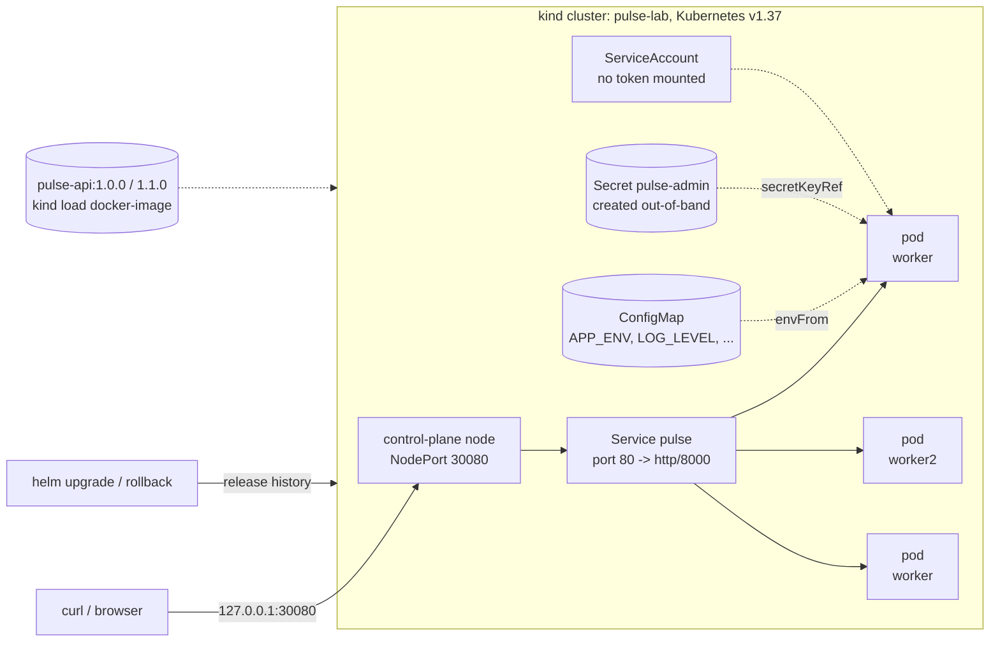

# Pulse Helm

**Purpose:** run Pulse on Kubernetes with production-safe defaults, and rehearse the failures that matter: a Helm chart plus a scripted release, failure and rollback runbook on a local 3-node cluster.

This repo contains a Helm chart for **pulse-api** (the container from [pulse](https://github.com/SammamMahdi/pulse)) and a reproducible lab on a local **3-node kind cluster**. The lab installs, scales and rolls out the service, breaks it on purpose in three different ways, diagnoses each failure with `kubectl` and recovers with `helm rollback`.

**Why it matters:** deploying a happy path is easy. The job is knowing:
- why a pod is not ready;
- why a rollout stalls without causing an outage;
- how to get back to a known-good release.

Every step below was executed, and the transcript is in [docs/verification.md](docs/verification.md).

## Architecture



## Chart features

| Area | Implementation |
|---|---|
| Workload | `Deployment` with a RollingUpdate strategy of `maxSurge: 1, maxUnavailable: 0`, plus topology spread across nodes |
| Probes | `startupProbe` and `livenessProbe` on `/health`, `readinessProbe` on `/ready` (separate concerns) |
| Graceful shutdown | Native `preStop: sleep: 5s`, so endpoints drop the pod before SIGTERM, with `terminationGracePeriodSeconds: 30` |
| Config | `ConfigMap` + `envFrom`. A `checksum/config` annotation rolls pods when config changes. |
| Secrets | The token is **never in values or git**. The chart references an existing Secret (`faultInjection.existingSecret`), created out-of-band (kubectl here; Key Vault CSI / External Secrets on AKS). Rendering fails if the reference is missing. |
| Security | `runAsNonRoot` (UID 10001), `readOnlyRootFilesystem`, `allowPrivilegeEscalation: false`, all capabilities dropped, `seccompProfile: RuntimeDefault`, `automountServiceAccountToken: false` |
| Resources | Requests and limits on every container, including the test pod |
| Image | `image.digest` (immutable) takes precedence over `image.tag`. `latest` and an empty tag are rejected. |
| Optional | HPA (`autoscaling/v2`), PodDisruptionBudget, NetworkPolicy (default-deny ingress plus listed peers), Ingress, all enabled in `values-prod.yaml` |
| Validation | `values.schema.json` rejects unsafe values: root, privilege escalation, writable root FS, bad digests, lowercase config keys |
| `helm test` | A test pod built from the app image (no extra image to trust) checks `/ready` and a real API call through the Service |

| Values file | Purpose |
|---|---|
| `values.yaml` | Secure defaults: 2 replicas, ClusterIP, GHCR image |
| `values-dev.yaml` | kind: 1 replica, NodePort 30080, side-loaded image (`pullPolicy: Never`), small resources |
| `values-prod.yaml` | Deploy by digest; HPA 3–6 at 70% CPU; PDB `minAvailable: 2`; NetworkPolicy; Ingress with TLS |

## Prerequisites

- Windows 11 with WSL2 (Ubuntu 24.04) and Docker Engine, or Docker Desktop (Linux and macOS also work).
- kind ≥ 0.30, kubectl, Helm 4.
- For `scripts/validate-chart.sh`: kubeconform and Trivy.
- The `pulse` repo next to this one, so `cluster-up.sh` can build the images (or have `pulse-api:1.0.0` and `pulse-api:1.1.0` already built).

## Run it

```bash
scripts/validate-chart.sh      # static: lint, render x4, kubeconform, trivy, 8 rejected-value checks
scripts/cluster-up.sh          # kind cluster (1 control plane + 2 workers) + side-load images
scripts/demo.sh | tee demo.log # the full lab, about 4 minutes
curl http://127.0.0.1:30080/api/v1/info
scripts/cluster-down.sh        # cleanup
```

Install by hand:

```bash
kubectl create namespace pulse
helm upgrade --install pulse charts/pulse -n pulse -f charts/pulse/values-dev.yaml --set image.tag=1.0.0 --wait
helm test pulse -n pulse --logs
```

## What the lab demonstrates (all executed, see docs/verification.md)

| Step | Result |
|---|---|
| Install 1.0.0 and run `helm test` | Pod Ready, endpoint registered, test passed |
| Secret wiring | Token injected (length 48, value never printed). Admin API: 401 without the token, 200 with the Secret's token. |
| Scale to 3 replicas via Helm | Pods on both workers; requests answered by different pods |
| Rolling update to 1.1.0 under traffic | **227 requests, 0 non-200** during the rollout |
| Broken image tag | `ErrImagePull` → `ImagePullBackOff`; Helm upgrade failed; **819 requests, 0 non-200** because old pods kept serving |
| Investigate | `describe pod` events, `rollout status` stalled, `helm history` shows the failed revision |
| `helm rollback` to the last good revision | Bad ReplicaSet removed; all pods on 1.1.0 |
| Crash-looping config | `CrashLoopBackOff`; `logs --previous` shows `ConfigError: MAX_PRIME_LIMIT must be an integer, got 'oops'`. Rolled back; `helm test` passed. |
| Readiness failure on one pod | Pod `0/1 Running`, **0 restarts**, endpoint `ready=false`; recovered when the fault was cleared |

## Design choices

- **Explicit values on every upgrade, not `--reuse-values`.** Each revision is then fully described by its command line. `--reuse-values` silently keeps stale overrides and ignores new chart defaults.
- **No `--rollback-on-failure` in the lab.** It is the right default in CD (Helm 4's replacement for `--atomic`), but here the point is to diagnose the failure by hand.
- **Readiness ≠ liveness.** A failing dependency should take a pod out of rotation (readiness), not restart it (liveness). Restarts don't fix dependencies and can cascade.
- **Scaling through Helm, not `kubectl scale`.** The release stays the source of truth, so the next upgrade does not silently revert the replica count.
- **Local images via `kind load`** with `pullPolicy: Never` in dev. The broken-image step switches to `IfNotPresent`, so the failure mode is a real registry pull (`ImagePullBackOff`).

## Security considerations

- The pods run with the restricted Pod Security Standard settings. You can enforce that per namespace with `pod-security.kubernetes.io/enforce: restricted`.
- No Kubernetes API token is mounted. The app never needs it, and a mounted token is the first thing an attacker uses after a compromise.
- Secrets are referenced, not templated. A Secret value placed in Helm values ends up in plain text in the release history (stored as a Secret, but readable by anyone with Secret read access) and in CI logs.
- The NetworkPolicy (prod values) is default-deny for ingress except listed peers. It needs a CNI that enforces policy, and enforcement was not tested on kind in this lab.

## Troubleshooting

See [docs/troubleshooting.md](docs/troubleshooting.md). It covers ImagePullBackOff, CrashLoopBackOff, not-ready pods, OOMKilled, Pending, a Service with no endpoints and a failed Helm upgrade, each with commands and the matching demo step.

## Cleanup

```bash
helm uninstall pulse -n pulse && kubectl delete namespace pulse
scripts/cluster-down.sh
```

## Running on AKS

See [docs/aks.md](docs/aks.md). **The lab was not deployed to AKS.** That page explains what changes (ACR with AcrPull, Key Vault CSI, workload identity, Azure network policy, managed Prometheus).

## Limitations and future improvements

- The HPA and NetworkPolicy templates are validated (kubeconform, Trivy, lint) but were **not exercised** on kind: metrics-server was not installed, and NetworkPolicy enforcement was not tested.
- Helm's `APP VERSION` column shows the chart's `appVersion` (1.0.0) even when `image.tag` is 1.1.0. The pods' `app.kubernetes.io/version` label shows the real tag. Bumping `appVersion` per release in CI would make these consistent.
- Next steps: GitOps with Argo CD (SELISE's public pipelines use Argo CD with Helm values), Gateway API instead of Ingress, and `helm-unittest` for template-level tests.

## License

MIT, see [LICENSE](LICENSE).
